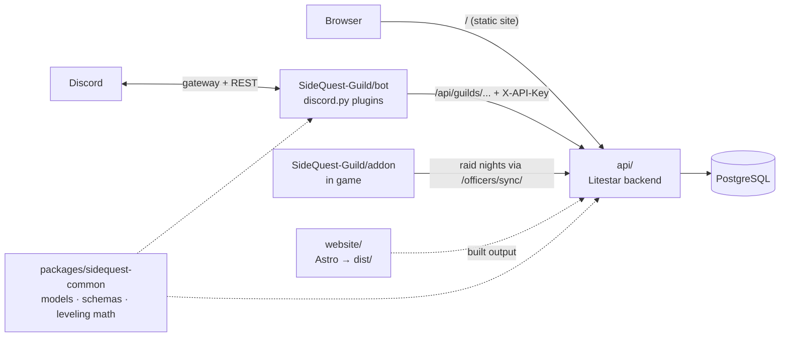

# SideQuest Guild website

The website and API for SideQuest, an Alliance guild on World of Warcraft: Forever. Members sign in with Discord,
sign up for events, check their loot points and see the Hall of Heroes. Officers run events, attendance and the
roster from the Officers page. It runs at [sidequest-guild.com](https://sidequest-guild.com).

Two other repos work with it: the Discord bot, [SideQuest-Guild/bot](https://github.com/SideQuest-Guild/bot), and the
in-game addon, [SideQuest-Guild/addon](https://github.com/SideQuest-Guild/addon). Neither one opens the database. They
both go through the API.



## What's on the site

| Page | Who sees it | What it's for |
|---|---|---|
| `/` | everyone | The next raid, who is in Discord right now, and what the guild is recruiting. |
| `/events/` | everyone | Upcoming and past events. Members also see who signed up, and can sign up themselves. |
| `/raids/` | everyone | How raid nights, SQL loot and attendance work. |
| `/ledger/` | everyone | Loot points for every raider, the loot rules, recent loot and boss kills. |
| `/heroes/` | members | The Hall of Heroes: Renown, raids attended, chat level and badges for each member. |
| `/guild/` | members | The in-game roster, who can craft what, the guild bank log and guild news. |
| `/addons/` | everyone | The addons the guild uses, with download links. |
| `/account/` | anyone signed in | Link Battle.net, get a calendar link, mark away dates, or delete your account. |
| `/officers/` | officers | Events, addons, recruiting and attendance. Game Masters also get members, the activity log and moderation. |
| `/officers/sync/` | officers | Move a raid night from the addon to the site, and points back to the addon. |
| `/rules/`, `/privacy/`, `/terms/` | everyone | Guild rules, what the site keeps about you, and the terms. |
| `/api-reference/` | everyone | The same API reference below, styled like the rest of the site. |

A **member** is anyone in the SideQuest Discord who has signed in. An **officer** holds Quest Master or Quest Guide,
and a **Game Master** holds Quest Master. Roles are read at sign-in and kept up to date by the bot, so a promotion in
Discord shows on the site within a few minutes.

## Run it on your computer

You need [uv](https://docs.astral.sh/uv/), [mise](https://mise.jdx.dev) and Docker. uv installs the right Python and
mise installs the right Node.

```sh
cp .env.example .env      # set API_KEY to any long random string
make install              # Python and Node packages
make db-up migrate        # start Postgres in Docker and create the tables
make dev                  # the site and the API at http://localhost:8000
```

`make dev` reloads as you edit. The site and the API share port 8000, so the sign-in cookie works on both.

Signing in needs a Discord app (see [Sign-in](#sign-in)). Without one, the public pages still work and the sign-in
button returns an error.

To run the bot against your local API, clone the bot repo and set its `API_URL` to `http://localhost:8000` and its
`API_KEY` to the same value as yours.

`make help` lists every command.

## Before you push

`make ci` runs every check GitHub runs: formatting, lint, type checks, the Python tests, the website checks, a build
and the browser tests. `make fmt` fixes formatting.

- **Python tests** (`make test`) start the real API with a fresh database for each test, so they don't need Postgres.
- **Browser tests** (`make web-e2e`; run `make web-e2e-install` once first) open every page in desktop Chrome, on an
  iPhone, an Android phone and a 320px phone. The API is faked from `website/e2e/data.ts`. A test fails if anything
  scrolls sideways, falls off the screen, doesn't load or logs an error. `npx playwright show-report` in `website/`
  shows the screenshots.
- **Type checks** fail only on new errors. Known ones are listed in `pyrefly-baseline.json`. After you fix some, run
  `make type-baseline`.

After you change a database model, `make migration MSG="add away dates"` writes the migration and `make migrate`
applies it.

## Where things are

| Folder | What's in it |
|---|---|
| `api/` | The API, built with Litestar. Each feature has a folder in `api/src/sidequest_api/domain/`. Migrations are in `api/src/sidequest_api/lib/migrations/`. |
| `website/` | The site, built with Astro. Pages are in `src/pages/`, page scripts in `src/scripts/`, paintings in `assets/`. |
| `packages/sidequest-common/` | The database models, the shape of every API request and reply, and the SQL loot rules. The bot uses it too. |
| `tests/` | Python tests. |
| `website/e2e/` | Browser tests. |

With the API running, `/schema` lists every route with what it takes and returns; `/api-reference/` on the site shows
the same thing, themed to match.

## How the pieces talk

- **The bot** calls `/api/guilds/{guild_id}/...` with the shared `API_KEY`. About once a minute it asks what changed
  (new events, sign-ups, who should hold which role) and reports what happened in Discord (button clicks, voice
  channels, name and role changes). A change on either side reaches the other within about a minute.
- **The addon** records raid nights in game. An officer sends one to the site from `/officers/sync/` by pasting a
  `SQX1:` string, uploading the addon's save file, or running `sidequest-sync`. The site sends points back as an
  `SQI1:` string for `/sq import`. Both formats are in `packages/sidequest-common/src/sidequest_common/schemas/`
  (`epgp.py` and `guild_hub.py`).
- **The bot pins `sidequest-common` to a commit of this repo.** If you change a schema the bot uses, keep the old
  fields working until the bot moves to the new commit.

## How the features work

**Events.** Each event on the site gets a Discord event and a thread in the events forum. The thread has Going, Maybe
and Can't buttons, so members can sign up from either place. Edits on the site reach Discord in about 15 seconds,
and edits in Discord reach the site at once. A repeating event keeps its next 14 days filled in as ordinary events,
each with its own sign-ups.

**Two kinds of points.** *Renown* is for the Hall of Heroes. Each event is worth some: a raid 10, a dungeon 5,
leveling and PvP 3, anything else 2, and an officer can change it for one event. *EP and GP* are the SQL loot
points. The addon records them and the site shows them on `/ledger/`. In the code and the API, Renown is still
called `ep`. The loot rules and prices are in `schemas/epgp.py`.

**Attendance.** Officers mark who came on the Officers page. Anyone who spent 30 minutes in voice during the event is
ticked already. Every number about who came (Hall of Heroes, badges, Renown, the attendance report) uses one rule,
`attended_condition()` in `api/src/sidequest_api/lib/attendance.py`. Use it for any new one too.

**Hall of Heroes and badges.** Seasons are listed in `SEASONS` in `schemas/heroes.py`. Season One starts on November
4, 2026. Each badge is also a Discord role, which the bot grants and announces.

| Badge | How to earn it |
|---|---|
| First Steps | Come to your first guild event. |
| First Raid | Come to your first raid. |
| Raid Regular | Come to 10 raids. |
| Raid Veteran | Come to 25 raids. |
| Perfect Month | Come to every raid in a month that had at least 4. |
| Founding Member | Be on the guild roster before launch. |
| Chatterbox | Reach chat level 10. |
| Top Helper | Come to the most dungeons and leveling groups last month. It moves to the next winner each month. |

**Discord roles from the site.** Signing in gives *Signed the Ledger*, and linking Battle.net gives *Battle-Tagged*.
New people who haven't signed in get *At the Gate*. When a Game Master confirms someone on the in-game roster, they
get *New Arrival*, which opens the guild channels. The bot checks every member once a minute, and it never hands out
a role with moderator powers or one above its own.

**Calendar and away dates.** Each member can get a private calendar link for Google or Apple Calendar with the events
they signed up for. Anyone with the link can read it, so "Make a new link" on `/account/` turns the old one off.
Members can also mark dates they'll be away. The bot gives them *Away on a Quest* for those days, and the raid chart
shows who is away.

**Your data.** If you start keeping something new about members, add it to `/privacy/` and make `delete_account` in
`api/src/sidequest_api/domain/members/services.py` remove it.

## MCP access for officers

Officers can let Claude Code, omp or any other MCP client work on the guild for them: look up members, read and
post in channels, post announcements, and make, change or cancel events. Make a token on `/officers/` under
**Claude / MCP access**, then run:

```sh
claude mcp add --transport http sidequest https://sidequest-guild.com/api/mcp --header "Authorization: Bearer <token>"
```

- The site shows the token once and keeps only a scrambled copy. Revoke it on the same page.
- It works only while you are an officer. A few tools, such as the attendance report, need a Game Master.
- No tool can hand out or take away a role with moderator powers, a role another app manages, or a role above the
  bot's own.
- Everything a token does shows in the log on `/officers/#log`, under your name.
- The site calls Discord with the bot's token (`DISCORD_TOKEN`). Without it, the Discord tools say so and the rest
  work.

The code is in `api/src/sidequest_api/domain/mcp/`.

## Sign-in

**Discord.** In the Discord Developer Portal, open the Game Master app, then OAuth2. Add the redirect
`http://localhost:8000/auth/discord/callback` (on the live site, `https://sidequest-guild.com/auth/discord/callback`).
Copy the client ID and secret into `WEB_DISCORD_CLIENT_ID` and `WEB_DISCORD_CLIENT_SECRET`, and set
`WEB_SESSION_SECRET` to a long random string. Without it, everyone is signed out each time the API restarts.

**Battle.net.** Make a client at [develop.battle.net](https://develop.battle.net/access/clients) with the redirect
`http://localhost:8000/auth/battlenet/callback`, and copy its ID and secret into `WEB_BATTLENET_CLIENT_ID` and
`WEB_BATTLENET_CLIENT_SECRET`. The site asks only for the BattleTag. It can't read characters yet, because Blizzard
hasn't said whether Forever will be in its API.

## Deploying

Push to `main`. When CI passes, Cabotage builds the Docker image, runs the migrations, then starts the new version.
It takes about 13 minutes. Two things to know:

- A push deploys only if its newest commit changes app files. A commit that touches only `.github/` deploys nothing,
  even if older commits under it were never deployed.
- For a minute the old and new versions run side by side, and the migrations run first. So a migration must work
  with the old code too: give new columns a default or let them be empty.

After each deploy, the **Deployed** workflow clears Cloudflare's cache and runs the browser tests against the live
site. `gh run list --workflow deployed.yml` shows how it went. Each deploy also starts two or three runs that skip
themselves, so look for the one that didn't.

The `Procfile` has two processes from the same image: `release` runs the migrations, and `web` serves the API and the
site. The health check path is `/health/live`. Settings for the live site:

| Setting | Value |
|---|---|
| `DB_URL` | `postgresql+asyncpg://...?ssl=verify-full`, built from the database's `SIDEQUEST_PG*` settings |
| `PGSSLROOTCERT` | the database's `SIDEQUEST_PGSSLROOTCERT` |
| `API_KEY` | a long random string, the same one the bot uses |
| `WEB_BASE_URL` | `https://sidequest-guild.com` |
| `WEB_COOKIE_SECURE` | `true` |
| `WEB_SESSION_SECRET` | at least 32 characters |
| `WEB_DISCORD_CLIENT_ID`, `WEB_DISCORD_CLIENT_SECRET` | the Discord app |
| `WEB_BATTLENET_CLIENT_ID`, `WEB_BATTLENET_CLIENT_SECRET` | the Battle.net client |
| `WEB_OFFICER_ROLE_IDS`, `WEB_GM_ROLE_IDS` | only to change who counts as an officer or Game Master |

To run the whole thing in Docker on your computer, use `make docker-up`, and `make docker-down` to stop it.

### Cloudflare

Cloudflare answers almost every request itself, so the server rarely sees a visitor.

| What | How long Cloudflare keeps it |
|---|---|
| `/_astro/*` (scripts, fonts, pictures) | a year. The file names change with every build. |
| Pages | a minute. After that it shows the copy it has while it fetches a new one. |
| `/api/discord/live` | 15 seconds. Everyone sees the same counts. |
| Everything else in `/api/` and `/auth/` | never kept |

A route is kept only if it sends a `Cloudflare-CDN-Cache-Control` header and skips the session, so it can never hand
one person's cookie to another. The cache rule is "Pages and live counts at the edge" on the `sidequest-guild.com`
zone. It ignores the query string, so every `/events/detail/?id=...` is one page. Smart Tiered Cache, 0-RTT and Early
Hints are on.

### Page scripts and the offline copy

Links change the page without a full reload. A page script must start with `onPage` from
`website/src/scripts/page.ts`, or it runs only on the first page a visitor opens.

After the first visit, a service worker (`website/service-worker/sw.js`) keeps every page, script and font on the
device, so pages open at once and work offline. Public data shows from the device first and updates when the fresh
copy arrives. The saved data is deleted on every sign-up, edit, sign-in and sign-out, so nobody sees another
person's data. To turn the service worker off, set `SERVICE_WORKER = false` in `website/astro.config.mjs` and deploy.
It deletes its copies and removes itself.
