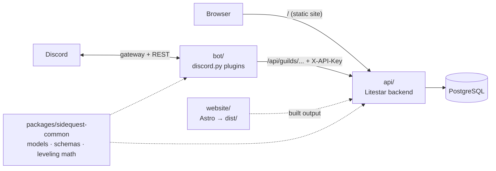

# SideQuest Guild

Everything for the SideQuest guild in one repo: the guild website, the Discord bot ("Game Master"), and a single
Litestar backend that serves both (and addons later). Structure follows [byte](https://github.com/JacobCoffee/byte):
a uv workspace where the backend owns the data and the bot talks to it over HTTP.



| Path | What lives there |
|---|---|
| `api/` | The Litestar backend: `domain/{guilds,levels,cases,role_menus,events,event_series,event_sync,system}`, migrations in `lib/migrations`, website serving in `lib/website.py` |
| `bot/` | Discord bot: `bot.py`, `api_client.py` (the only way the bot reaches the backend), `plugins/*` (auto-loaded), `lib/` |
| `website/` | Guild website (Astro, static build). Its built `website/dist/` is served by the backend at `/` |
| `packages/sidequest-common` | ORM models, pydantic schemas (the API contract), leveling curve, message templates, settings |
| `tests/` | API tests run the real app on a per-test SQLite DB; bot tests cover the pure logic behind each plugin |

### Routes

| Path | Auth | Purpose |
|---|---|---|
| `/` | none | Website (`website/dist`, built by `make web-build`; a placeholder page until the first build) |
| `/api/guilds/{guild_id}/...` | `X-API-Key` (shared secret with the bot) | Guild config, XP/levels, moderation cases, role menus |
| `/api/guilds/{guild_id}/event-sync` (GET), `/event-sync/{event_id}/ack`, `/event-sync/events`, `/event-sync/events/{event_id}` (DELETE), `/event-sync/tombstones/{event_id}` (DELETE), `/event-sync/reconcile` | `X-API-Key` | Two-way guild event <-> Discord scheduled event sync (404s for any guild other than the site guild) |
| `/api/guilds/{guild_id}/live` (PUT) | `X-API-Key` | Bot reports the guild's live online/member/voice-channel counts (404s for any guild other than the site guild) |
| `/api/discord/live` (GET) | none | Website reads the site guild's live counts; empty counts (not 404) if the bot hasn't reported recently |
| `/auth/discord/login`, `/auth/discord/callback`, `/auth/logout` | none | Discord OAuth sign-in (session cookie `sq_session`) |
| `/auth/battlenet/link`, `/auth/battlenet/callback`, `/auth/battlenet/unlink` | signed in | Link a Battle.net account (BattleTag) to the member |
| `/api/me` | signed in | The signed-in member |
| `/api/members` | officer | Everyone who has signed in, with linked BattleTags, for checking the guild roster |
| `/api/events`, `/api/event-series`, `/api/addons` (GET) | none | Guild events (raids, dungeons, leveling, pvp, social, other) with roster + raid chart, repeating event series, guild addon links |
| `/api/events/{id}/signup` | guild member | Sign up for / withdraw from a guild event |
| `/api/events`, `/api/event-series`, `/api/addons` (POST/PATCH/DELETE), `/api/events/{id}/signups/{id}` | officer | Manage guild events, repeating event series, the raid chart and addons |
| `/health`, `/health/live` | none | Health checks |
| `/schema` | none | OpenAPI docs |

Only the bot's guild router is behind the bot key. Members sign in with Discord: a "guild member" is anyone in the
SideQuest server, and an officer is a member holding a role listed in `WEB_OFFICER_ROLE_IDS` (roles and nickname
refresh at each sign-in). The site's member pages are `/events/`, `/addons/`, `/account/` and `/officers/`.

### Discord sign-in setup

In the Developer Portal → Game Master → OAuth2, add the redirect `{WEB_BASE_URL}/auth/discord/callback` (locally
`http://localhost:8000/auth/discord/callback`) and copy the client ID and secret into `WEB_DISCORD_CLIENT_ID` and
`WEB_DISCORD_CLIENT_SECRET`. Set `WEB_SESSION_SECRET` to a long random string (without it, sessions end on every
restart), `WEB_OFFICER_ROLE_IDS` to a JSON list of officer role IDs (e.g. `[123456789012345678]`), and
`WEB_COOKIE_SECURE=true` behind HTTPS. Until the client ID and secret are set, sign-in returns 503 and the public
pages keep working. See `.env.example`.

### Battle.net linking setup

Signed-in members can link Battle.net from `/account/`; officers then see each BattleTag on `/officers/` and match it
against the in-game roster. Linking asks only for the `openid` scope (account id + BattleTag). Characters aren't read:
Blizzard hasn't said whether World of Warcraft: Forever will be in its Profile API. One Battle.net account can be
linked to only one member.

Create a client at [develop.battle.net/access/clients](https://develop.battle.net/access/clients) with the redirect
`{WEB_BASE_URL}/auth/battlenet/callback` (production `https://sidequest-guild.com/auth/battlenet/callback`, locally
`http://localhost:8000/auth/battlenet/callback`), then set `WEB_BATTLENET_CLIENT_ID` and
`WEB_BATTLENET_CLIENT_SECRET`. Blizzard notes changes can take up to 10 minutes to apply.

## Running locally

Requires uv (Python 3.15 is installed from `.python-version`), [mise](https://mise.jdx.dev) (the website's Node is
pinned in `website/mise.toml`), Docker (for Postgres), and the bot's token (Developer Portal → Game Master → Bot). The
bot needs the **Server Members** and **Message Content** privileged intents enabled in the portal, plus the
**Manage Events** server permission (Create Events + Manage Events) for event sync.

```bash
cp .env.example .env              # then set API_KEY to a random secret
make install                      # uv sync + the website's Node and npm packages
make db-up migrate                # Postgres in Docker + apply migrations
make dev                          # API + Astro dev server, hot reload, both on http://localhost:8000
make bot                          # in another terminal
```

`make dev` runs the API with `VITE_DEV_MODE=1` (litestar-vite's `VitePlugin`, `mode="framework"`) and the Astro dev
server together; Litestar proxies every request it doesn't own to Astro, so the browser only ever talks to
`http://localhost:8000` and `/api`, `/auth` and the site share one cookie jar. For production, build once and run the
API alone: `make web-build` (site into `website/dist`) then `make api` (serves `/` from that build, themed 404 for
unknown paths). `make web-dev` on its own still works too (plain Astro on `http://localhost:4321`, not proxied).

`make bot` uses `DISCORD_TOKEN` from the environment or `.env`; if neither is set it reads the macOS Keychain item
`discord-mcp` (the same token the Discord MCP server uses), so the token never has to sit in a file.
`DISCORD_GUILD_ID` makes slash commands sync to that server instantly instead of globally.

`make ci` runs what GitHub Actions runs: ruff format and lint, pyrefly, codespell, the test suite (deprecation warnings
are errors), and for the website oxfmt, oxlint, `astro check`, and a build. pyrefly fails only on type errors that
aren't recorded in `pyrefly-baseline.json`; after fixing some, `make type-baseline` re-records it. `make fmt` formats
both sides, `make lint` runs every prek hook (`make install-prek` installs them), and `make help` lists the rest.
`make migration MSG="..."` autogenerates a migration after a model change.

The website's Discord buttons read one constant, `DISCORD_INVITE` in `website/src/config.ts`. Its paintings live in
`website/assets/plates/` and are resized to WebP at build time.

## Features

Admin command groups are hidden from members without the listed permission (server admins can re-scope them under
Server Settings → Integrations). Every config change is stored by the API and applies immediately.

### Leveling
Every message earns 15–25 XP, at most once per 60 s per member, on MEE6's curve (`5n² + 50n + 100` XP from level
`n` to `n+1`). Level-ups post `GG {mention}, you just advanced to level {level}!` in the same channel unless a
level-up channel is set. Milestone roles (`Lv 5 · Wayfarer` … `Lv 50 · Legend`) are granted automatically; they're
cosmetic and sit below the rank roles, so rank colors and member-list groups stay in charge.

- `/rank [member]`, `/leaderboard [page]`
- `/levels reward set|remove|list` · `/levels set-xp` (Manage Server)
- `/levels config enabled | level-up-channel | level-up-message | xp-range | cooldown | stacking | no-xp-channel-add/remove | no-xp-role-add/remove`

### Logging (`#guild-log`)
Message edits/deletes (with the original text), bulk deletes (with a transcript file), joins (new accounts flagged),
leaves, nickname/role/timeout changes, bans/kicks/unbans by humans (with moderator and reason), channel and role
changes, and voice joins/leaves/moves. The bot's own moderation actions are logged as cases instead.

- `/logging channel <channel|none>`, `/logging status` (Manage Server)

### Welcome
New members get the auto-role (**New Arrival**) and a welcome message in `#general`. If membership screening is on,
both wait until the member accepts the rules. Placeholders: `{mention}` `{user}` `{guild}` `{member_count}`.

- `/welcome channel | message | autorole | test | status` (Manage Server)

### Role menus
Button panels for self-assignable roles. Buttons keep working across bot restarts. `max_roles` limits picks per menu.

- `/rolemenu create | add | remove | edit | delete | list | refresh` (Manage Roles)

### Moderation
Each action DMs the member (if possible), records a numbered case, and posts it to the log channel. Moderators can't
act on the owner, the bot, themselves, or anyone whose top role is at or above theirs.

- `/warn`, `/timeout <duration like 10m, 1h30m, 2d>`, `/untimeout` (Timeout Members)
- `/kick` (Kick Members) · `/ban [delete_message_days]`, `/unban <user id>` (Ban Members)
- `/cases [member]`, `/case <number>`, `/reason <number> <text>`

### Automod
Deletes invite links (on by default) and optionally all links; for mention spam (more than 5 mentions) or message
floods (more than 5 messages in 5 s) it also times the member out for 5 minutes. Each hit is recorded as an `automod`
case. Members with Manage Messages, exempt roles, and exempt channels are skipped.

- `/automod status | toggle | mentions | spam | timeout | exempt role|channel add|remove` (Manage Server)

### Status line
The bot's activity rotates every 3 minutes: a countdown to the WoW: Forever launch (Nov 4, counted in US Central;
"Playing World of Warcraft: Forever" afterwards), the next guild event ("Next up: Molten Core, in 3h"), and a few
Azeroth jokes. While an event is running it stays on "Competing in {event}". Bots can't show Rich Presence art,
buttons or timers, only this one line (`bot/src/sidequest_bot/plugins/presence.py`).

### Event sync
Guild events created, edited, or cancelled on the site appear as Discord scheduled events, and events created,
edited, or deleted in Discord update the matching guild event, in either direction. Site edits reach Discord within
about 15 seconds (the bot's sync loop interval); Discord edits reach the site immediately via gateway listeners.
Requires the bot's **Manage Events** permission; without it, sync pauses for that server until the permission is
restored.

- Each Discord event's description ends with a `── SideQuest event ──` block: the event's kind, location and size,
  live sign-up counts, and a sign-up link built from `WEB_BASE_URL` (so set it to the public domain in production).
  Text above that block is the event's notes in both directions. Occurrences of a repeating series add the rule
  (e.g. `Every Friday`, `Every other Friday`) to that line.
- Events made in Discord become guild events of kind `other` with no location or size; officers can fill those in on
  the site.
- Deleting an event in Discord cancels its guild event on the site and keeps the sign-ups; deleting a guild event on
  the site deletes its Discord event. Events that already started aren't created in Discord (Discord rejects past
  starts).
- The bot reconciles every event when it starts, so changes made while it was offline are picked up.
- Officers create repeating events (`POST /api/event-series`: weekdays, interval, time, timezone, optional end date)
  and the API keeps the next 14 days of occurrences materialized as ordinary guild events, each with its own
  sign-ups and Discord event, so the bot's sync loop and `GET /api/events` always see real, signable events rather
  than the series rule itself. Editing a single occurrence detaches it from the series; editing the series updates
  its still-attached future occurrences (re-timing or cancelling ones a schedule change no longer matches); ending
  a series cancels its signed-up future occurrences and deletes the signup-less ones, keeping past occurrences.

### Live status
The homepage "In the Discord" band shows live counts, never names: how many people are in each public voice/stage
channel, plus the guild's approximate online/member counts. Every 60 seconds the bot refreshes
`approximate_presence_count`/`approximate_member_count` (`fetch_guild(..., with_counts=True)`, keeping the last
known values if that fetch fails) and pushes a full report; voice/stage channel changes also push immediately,
debounced ~5 seconds per guild so a burst of joins/leaves coalesces into one push (mute/deafen toggles don't count
as a channel change). No privileged presence intent is used
(`bot/src/sidequest_bot/plugins/live_status.py`, `PUT /api/guilds/{guild_id}/live`).

## Role safety
Anything the bot hands out on its own (level rewards, the auto-role, role-menu buttons) goes through
`bot/src/sidequest_bot/lib/roles.py`:

- **The role itself:** it must be below the bot's role, not managed by an integration, and free of moderator/admin
  permissions. This is re-checked right before every grant, so a role that later gains permissions stops being
  handed out.
- **Who configures it:** they need Manage Roles, and the role must sit below their own highest role.

## Deploying with Docker
Host-agnostic: a single multi-stage `Dockerfile` builds the website (Node 24) and the Python workspace (uv) into one
slim Python 3.15 image. The image's default command runs the API (`sidequest-api`); the same image runs the bot with
`sidequest-bot` as the container command. `docker-compose.yml` wires up Postgres, a one-shot `migrate` service
(`litestar database upgrade`) that runs before the API starts, the `api` service (port 8000), and a `bot` service
behind the `bot` Compose profile so it never starts without a token.

```bash
cp .env.example .env            # set API_KEY, DISCORD_TOKEN, etc.
make docker-build                # build the image
make docker-up                   # postgres + migrate + api (http://localhost:8000)
make docker-migrate              # re-run migrations on demand
docker compose --profile bot up -d bot   # start the bot (needs DISCORD_TOKEN in .env)
make docker-logs                 # follow logs
make docker-down                 # stop everything (keeps the pgdata volume)
```

`API_HOST=0.0.0.0` is baked into the image so it binds inside the container; `API_PORT` stays 8000. The image has a
`HEALTHCHECK` against `/health`. `.dockerignore` keeps `.venv`, `node_modules`, `dist`, caches, and tests out of the
build context. CI builds the image (no push) on every PR via `docker/build-push-action` with GitHub Actions layer
caching.

### Cabotage
The `Procfile` defines the three processes, all from the same image:

| Process | Command | Notes |
|---|---|---|
| `release` | `litestar … database upgrade --no-prompt` | Runs once per deploy, before traffic |
| `web` | `uvicorn … --uds /var/run/cabotage/cabotage.sock` | Serves the API and the built site |
| `worker` | `sidequest-bot` | Run **exactly one** replica: two bots would double every Discord event push |

Set the health check path to **`/health/live`** (no database round-trip, fits the 2 s probe timeout). The site's
canonical and og URLs are baked in at build time from the `SITE_URL` build arg, which defaults to
`https://sidequest-guild.com`.

Environment (secrets in Vault, the rest in Consul):

| Variable | Value | Used by |
|---|---|---|
| `DB_URL` | `postgresql+asyncpg://{PGUSER}:{PGPASSWORD}@{PGHOST}:{PGPORT}/{PGDATABASE}?ssl=verify-full`, built from the database's shared `SIDEQUEST_PG*` variables (scheme must be `postgresql+asyncpg`; asyncpg takes `ssl=`, not `sslmode=`) | release, web |
| `PGSSLROOTCERT` | the shared `SIDEQUEST_PGSSLROOTCERT` (`/var/run/secrets/cabotage.io/ca.crt`); asyncpg verifies the server against it | release, web |
| `API_KEY` | shared secret (`secrets.token_urlsafe(32)`) | web, worker |
| `API_URL` | `https://sidequest-guild.com`: the bot reaches the API through the public site | worker |
| `DISCORD_TOKEN` | bot token | worker |
| `DISCORD_GUILD_ID` | `1564671275316543508` (instant slash-command sync) | worker |
| `WEB_BASE_URL` | `https://sidequest-guild.com` | web |
| `WEB_COOKIE_SECURE` | `true` | web |
| `WEB_SESSION_SECRET` | at least 32 characters | web |
| `WEB_DISCORD_CLIENT_ID` / `WEB_DISCORD_CLIENT_SECRET` | Discord OAuth app | web |
| `WEB_BATTLENET_CLIENT_ID` / `WEB_BATTLENET_CLIENT_SECRET` | Battle.net API client | web |
| `WEB_OFFICER_ROLE_IDS` | `1564678042381586532,1564678035117178960` | web |

Register `https://sidequest-guild.com/auth/discord/callback` as a Discord OAuth redirect (the Battle.net one is
already registered).
