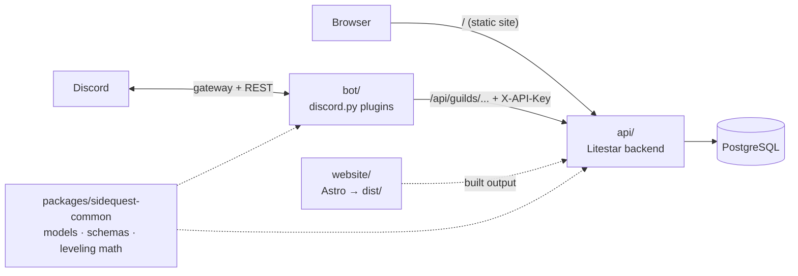

# SideQuest Guild

Everything for the SideQuest guild in one repo: the guild website, the Discord bot ("Game Master"), and a single
Litestar backend that serves both (and addons later). Structure follows [byte](https://github.com/JacobCoffee/byte):
a uv workspace where the backend owns the data and the bot talks to it over HTTP.



| Path | What lives there |
|---|---|
| `api/` | The Litestar backend: `domain/{guilds,levels,cases,role_menus,events,event_series,event_sync,system}`, migrations in `lib/migrations`, website serving in `lib/website.py` |
| `bot/` | Discord bot: `bot.py`, `api_client.py` (the only way the bot reaches the backend), `plugins/*` (auto-loaded), `lib/` |
| `website/` | Guild website (Astro, static build). Its built `website/dist/` is served by the backend at `/` |
| `packages/sidequest-common` | ORM models, pydantic schemas (the API contract), leveling curve, message templates, settings |
| `tests/` | API tests run the real app on a per-test SQLite DB; bot tests cover the pure logic behind each plugin |

### Routes

| Path | Auth | Purpose |
|---|---|---|
| `/` | none | Website (`website/dist`, built by `make web-build`; a placeholder page until the first build) |
| `/api/guilds/{guild_id}/...` | `X-API-Key` (shared secret with the bot) | Guild config, XP/levels, moderation cases, role menus |
| `/api/guilds/{guild_id}/event-sync` (GET), `/event-sync/{event_id}/ack`, `/event-sync/events`, `/event-sync/events/{event_id}` (DELETE), `/event-sync/tombstones/{event_id}` (DELETE), `/event-sync/reconcile`, `/event-sync/interest/{discord_event_id}` (PUT), `/event-sync/activity/ack` | `X-API-Key` | Two-way guild event <-> Discord scheduled event sync, Discord "Interested" reporting, and sign-up activity for forum comments (404s for any guild other than the site guild) |
| `/api/guilds/{guild_id}/live` (PUT) | `X-API-Key` | Bot reports the guild's live online/member/voice-channel counts (404s for any guild other than the site guild) |
| `/api/guilds/{guild_id}/roles` (PUT) | `X-API-Key` | Bot reports the guild's full current role set (names, colors, positions); `@everyone` excluded (404s for any guild other than the site guild) |
| `/api/guilds/{guild_id}/member-links` (GET) | `X-API-Key` | Bot reads every signed-in member's Discord id and Battle.net-link status for role syncing (404s for any guild other than the site guild) |
| `/api/guilds/{guild_id}/member-profiles` (PUT) | `X-API-Key` | Bot pushes linked members' current Discord username/global name/nick/avatar/roles (full sweep plus debounced pushes on profile/role/membership changes), and reports departed linked members; only updates existing members, never creates them (404s for any guild other than the site guild) |
| `/api/guilds/{guild_id}/signup-notices` (GET), `/signup-notices/{member_id}/ack` (POST) | `X-API-Key` | New-signup officer notice outbox: members with no notice posted yet, and posted notices whose message is stale (confirmed since, e.g. on the site); the bot acks a message's channel/message id once it accurately reflects the member's state (404s for any guild other than the site guild) |
| `/api/guilds/{guild_id}/role-resets` (GET), `/role-resets/{reset_id}/ack` (POST) | `X-API-Key` | Discord role-reset outbox: members whose site account was deleted and still need every manageable Discord role stripped (requested_at oldest first, capped at 50; unacked rows older than 7 days are dropped); the bot acks once it has acted, or immediately if the member already left the guild (404s for any guild other than the site guild) |
| `/api/guilds/{guild_id}/events/{event_id}/signups/by-discord/{discord_id}` (GET, PUT) | `X-API-Key` | Bot reads/writes a member's event signup by Discord id, for the Discord Going/Maybe/Can't buttons (reuses the same upsert as the site's own sign-up form); 404 for a `discord_id` with no site account or any `guild_id` other than the site guild, 409 if the event isn't scheduled |
| `/api/guilds/{guild_id}/attendance/voice` (PUT) | `X-API-Key` | Bot reports cumulative per-event voice minutes for every member it's tracked in the guild's voice channels while an event runs (idempotent replace, not increment; 404s for any guild other than the site guild) |
| `/api/discord/live` (GET) | none | Website reads the site guild's live counts; empty counts (not 404) if the bot hasn't reported recently |
| `/api/heroes` (GET) | signed in or `X-API-Key` | Hall of Heroes leaderboard for `?season=<id\|all\|month>`, highest EP first |
| `/api/heroes/{member_id}` (GET) | signed in or `X-API-Key` | One member's Hall of Heroes profile: season/all-time stats, rank, chat level/XP, recent events, earned badges |
| `/api/discord/online` (GET) | signed-in guild member | Trims Discord's public server widget (`https://discord.com/api/guilds/{id}/widget.json`) to `presence_count` plus each member's name/status/avatar/activity, cached in-process ~60s; `ok: false` with an empty list if the widget fetch fails or times out (3s) rather than a 500. Never edge-cached (varies by session). |
| `/auth/discord/login`, `/auth/discord/callback`, `/auth/logout` | none | Discord OAuth sign-in (session cookie `sq_session`) |
| `/auth/battlenet/link`, `/auth/battlenet/callback`, `/auth/battlenet/unlink` | signed in | Link a Battle.net account (BattleTag) to the member |
| `/api/me` (GET), `/api/me` (DELETE) | signed in | The signed-in member; `DELETE` permanently deletes the member, their event signups, and their sign-up activity rows, clears the session cookie, and queues a Discord role-reset outbox row so the bot strips the member's Discord roles |
| `/api/members/{member_id}/roster-confirmation` (PUT, DELETE) | GM | Confirm or clear that a member is on the in-game guild roster |
| `/api/events`, `/api/event-series`, `/api/addons` (GET) | none | Guild events (raids, dungeons, leveling, pvp, social, transmog, other) with roster + raid chart, attendance EP, repeating event series, guild addon links (each addon carries an `origin` of `guild` or `community`); anonymous `/api/events` requests get the headline fields only (title, kind, time, location) — notes, counts, signups and Discord interest are `null`/empty unless the caller is signed in or presents the bot's `X-API-Key` |
| `/api/events/{id}/signup` | guild member | Sign up for / withdraw from a guild event |
| `/api/events`, `/api/event-series`, `/api/addons` (POST/PATCH/DELETE), `/api/events/{id}/signups/{id}` | officer | Manage guild events, repeating event series, the raid chart and addons |
| `/api/attendance/events` (GET), `/api/events/{id}/attendance` (GET, PUT) | officer | Past events still needing attendance, an event's sign-up roster with voice minutes, and marking Came/No-show plus walk-ins (audited as `attendance.mark`; 409 before the event starts or once cancelled) |
| `/api/attendance/report`, `/api/attendance/trends` (GET) | GM | Per-member attendance counts/rate and weekly attendee/show-rate trends for `?window=last_30\|season\|all_time&raids_only=` |
| `/api/gm/members`, `/api/gm/members/{member_id}`, `/api/gm/log`, `/api/gm/cases` (GET), `/api/gm/cases/{case_number}` (PATCH) | GM | Member management detail, unified activity log (sign-ups, sign-ins, Battle.net links, officer actions, moderation), and moderation case review/edit |
| `/health`, `/health/live` | none | Health checks |
| `/schema` | none | OpenAPI docs |

Only the bot's guild router is behind the bot key. Members sign in with Discord: a "guild member" is anyone in the
SideQuest server, an officer is a member holding a role listed in `WEB_OFFICER_ROLE_IDS` (default: Quest Master and
Quest Guide), and a GM is a member holding a role listed in `WEB_GM_ROLE_IDS` (default: Quest Master); roles and
nickname refresh at each sign-in and continuously thereafter via the bot's member-profile push (see "Member
profile sync" below). The site's member pages
are `/events/`, `/heroes/`, `/addons/`, `/account/` and `/officers/` (the GM console).

### Discord sign-in setup

In the Developer Portal → Game Master → OAuth2, add the redirect `{WEB_BASE_URL}/auth/discord/callback` (locally
`http://localhost:8000/auth/discord/callback`) and copy the client ID and secret into `WEB_DISCORD_CLIENT_ID` and
`WEB_DISCORD_CLIENT_SECRET`. Set `WEB_SESSION_SECRET` to a long random string (without it, sessions end on every
restart), `WEB_OFFICER_ROLE_IDS` / `WEB_GM_ROLE_IDS` only to override the SideQuest role defaults, and
`WEB_COOKIE_SECURE=true` behind HTTPS. Until the client ID and secret are set, sign-in returns 503 and the public
pages keep working. See `.env.example`.

### Battle.net linking setup

Signed-in members can link Battle.net from `/account/`; officers then see each BattleTag on `/officers/` and match it
against the in-game roster. Linking asks only for the `openid` scope (account id + BattleTag). Characters aren't read:
Blizzard hasn't said whether World of Warcraft: Forever will be in its Profile API. One Battle.net account can be
linked to only one member.

Create a client at [develop.battle.net/access/clients](https://develop.battle.net/access/clients) with the redirect
`{WEB_BASE_URL}/auth/battlenet/callback` (production `https://sidequest-guild.com/auth/battlenet/callback`, locally
`http://localhost:8000/auth/battlenet/callback`), then set `WEB_BATTLENET_CLIENT_ID` and
`WEB_BATTLENET_CLIENT_SECRET`. Blizzard notes changes can take up to 10 minutes to apply.

## Running locally

Requires uv (Python 3.15 is installed from `.python-version`), [mise](https://mise.jdx.dev) (the website's Node is
pinned in `website/mise.toml`), Docker (for Postgres), and the bot's token (Developer Portal → Game Master → Bot). The
bot needs the **Server Members** and **Message Content** privileged intents enabled in the portal, plus the
**Manage Events** server permission (Create Events + Manage Events) for event sync, and, if using the events
forum, **Manage Channels** (forum tags), **Send Messages in Threads**, and **Create Posts**.

```bash
cp .env.example .env              # then set API_KEY to a random secret
make install                      # uv sync + the website's Node and npm packages
make db-up migrate                # Postgres in Docker (host port 55432, clear of other projects' 5432) + migrations
make dev                          # API + Astro dev server, hot reload, both on http://localhost:8000
make bot                          # in another terminal
```

`make dev` runs the API with `VITE_DEV_MODE=1` (litestar-vite's `VitePlugin`, `mode="framework"`) and the Astro dev
server together; Litestar proxies every request it doesn't own to Astro, so the browser only ever talks to
`http://localhost:8000` and `/api`, `/auth` and the site share one cookie jar. For production, build once and run the
API alone: `make web-build` (site into `website/dist`) then `make api` (serves `/` from that build, themed 404 for
unknown paths). `make web-dev` on its own still works too (plain Astro on `http://localhost:4321`, not proxied).

`make bot` uses `DISCORD_TOKEN` from the environment or `.env`; if neither is set it reads the macOS Keychain item
`discord-mcp` (the same token the Discord MCP server uses), so the token never has to sit in a file.
`DISCORD_GUILD_ID` makes slash commands sync to that server instantly instead of globally.

`make ci` runs what GitHub Actions runs: ruff format and lint, pyrefly, codespell, the test suite (deprecation warnings
are errors), and for the website oxfmt, oxlint, `astro check`, a build, and the end-to-end tests. pyrefly fails only on
type errors that aren't recorded in `pyrefly-baseline.json`; after fixing some, `make type-baseline` re-records it.
`make fmt` formats both sides, `make lint` runs every prek hook (`make install-prek` installs them), and `make help`
lists the rest. `make migration MSG="..."` autogenerates a migration after a model change.

### End-to-end tests
`make web-e2e` builds the site and runs it in Playwright (`website/e2e/`): desktop Chrome, iPhone (WebKit, the engine
of every iPhone browser), Android Chrome and a 320px phone. The API is mocked from `e2e/data.ts` (typed against
`src/scripts/api.ts`), so no database is needed; an API call the mock doesn't handle, or any page error, fails the
test. Run `make web-e2e-install` once for the browsers.

- `layout.spec.ts`: every page, signed out and in, at every size: nothing scrolls sideways or sits past the screen
  edge, the painting spans the screen, pictures on screen load, the header fits; plus each officers console tab at
  1568px (desktop project only), with the addon list full and empty. Screenshots of each land in
  `website/test-results/` and the HTML report (`npx playwright show-report` in `website/`).
- `navigation.spec.ts`: links change the page in place (desktop nav and phone menu), back works, sign-in is a full load,
  the Officers link is for officers only.
- `pages.spec.ts`: what each page shows signed out, to members, officers and GMs; signing up for a raid, and the raid
  chart's "Suggest groups" preview/Apply and drag-and-drop.
- `offline.spec.ts`: after one visit the service worker opens pages with the network off.

`npm run test:unit` (`website/`) runs the raid chart suggestion heuristic's own unit tests
(`src/scripts/raid-suggest.test.ts`) with Node's built-in test runner — no browser needed.

`E2E_BASE_URL=https://sidequest-guild.com npm run e2e` runs the same tests against a deployed site (the API stays
mocked). The `Deployed` workflow (`.github/workflows/deployed.yml`) does that after every production web deploy: Cabotage
reports each deploy to GitHub as a deployment, and on its `success` status the workflow purges Cloudflare's cache, then
runs the suite against the live site. A failure shows on the commit's checks with the report and screenshots attached.

The website's Discord buttons read one constant, `DISCORD_INVITE` in `website/src/config.ts`. Its paintings live in
`website/assets/plates/` and are resized to WebP at build time.

## Features

Admin command groups are hidden from members without the listed permission (server admins can re-scope them under
Server Settings → Integrations). Every config change is stored by the API and applies immediately.

### Leveling
Every message earns 15–25 XP, at most once per 60 s per member, on MEE6's curve (`5n² + 50n + 100` XP from level
`n` to `n+1`). Level-ups post `GG {mention}, you just advanced to level {level}!` in the same channel unless a
level-up channel is set. Milestone roles (`Lv 5 · Wayfarer` … `Lv 50 · Legend`) are granted automatically; they're
cosmetic and sit below the rank roles, so rank colors and member-list groups stay in charge.

- `/rank [member]`, `/leaderboard [page]`
- `/levels reward set|remove|list` · `/levels set-xp` (Manage Server)
- `/levels config enabled | level-up-channel | level-up-message | xp-range | cooldown | stacking | no-xp-channel-add/remove | no-xp-role-add/remove`

### Logging (`#guild-log`)
Message edits/deletes (with the original text), bulk deletes (with a transcript file), joins (new accounts flagged),
leaves, nickname/role/timeout changes, bans/kicks/unbans by humans (with moderator and reason), channel and role
changes, and voice joins/leaves/moves. The bot's own moderation actions are logged as cases instead.

- `/logging channel <channel|none>`, `/logging status` (Manage Server)

### Welcome
New members get the auto-role (**New Arrival**) and a welcome message in `#general`. If membership screening is on,
both wait until the member accepts the rules. Placeholders: `{mention}` `{user}` `{guild}` `{member_count}`.

- `/welcome channel | message | autorole | test | status` (Manage Server)

### Role menus
Button panels for self-assignable roles. Buttons keep working across bot restarts. `max_roles` limits picks per menu.

- `/rolemenu create | add | remove | edit | delete | list | refresh` (Manage Roles)

### Class halls
A forum post named `<role name> Hall` (e.g. `Warrior Hall` for `@Warrior`) belongs to that role. Gaining the role
adds the member to the post, so it shows in their channel list; losing the role takes them out. Anyone who can see
the forum can still browse and follow any hall. No config: the bot pairs roles and posts by name, indexes halls at
startup and every 6 hours (adding role holders it missed while offline, never removing anyone), and picks up new
hall posts as they're created. Needs Manage Threads to reopen archived halls. In SideQuest, `#choose-your-class` is
a role menu for the nine class roles and `#class-halls` holds their halls.

### Moderation
Each action DMs the member (if possible), records a numbered case, and posts it to the log channel. Moderators can't
act on the owner, the bot, themselves, or anyone whose top role is at or above theirs.

- `/warn`, `/timeout <duration like 10m, 1h30m, 2d>`, `/untimeout` (Timeout Members)
- `/kick` (Kick Members) · `/ban [delete_message_days]`, `/unban <user id>` (Ban Members)
- `/cases [member]`, `/case <number>`, `/reason <number> <text>`

### Automod
Deletes invite links (on by default) and optionally all links; for mention spam (more than 5 mentions) or message
floods (more than 5 messages in 5 s) it also times the member out for 5 minutes. Each hit is recorded as an `automod`
case. Members with Manage Messages, exempt roles, and exempt channels are skipped.

- `/automod status | toggle | mentions | spam | timeout | exempt role|channel add|remove` (Manage Server)

### Status line
The bot's activity rotates every 3 minutes: a countdown to the WoW: Forever launch (Nov 4, counted in US Central;
"Playing World of Warcraft: Forever" afterwards), the next guild event ("Next up: Molten Core, in 3h"), and a few
Azeroth jokes. While an event is running it stays on "Competing in {event}". Bots can't show Rich Presence art,
buttons or timers, only this one line (`bot/src/sidequest_bot/plugins/presence.py`).

### Event sync
Guild events created, edited, or cancelled on the site appear as Discord scheduled events, and events created,
edited, or deleted in Discord update the matching guild event, in either direction. Site edits reach Discord within
about 15 seconds (the bot's sync loop interval); Discord edits reach the site immediately via gateway listeners.
Requires the bot's **Manage Events** permission; without it, sync pauses for that server until the permission is
restored.

- Each Discord event's description ends with a `── SideQuest event ──` block: the event's kind, location and size,
  live sign-up counts, and a sign-up link built from `WEB_BASE_URL` (so set it to the public domain in production).
  Text above that block is the event's notes in both directions. Occurrences of a repeating series add the rule
  (e.g. `Every Friday`, `Every other Friday`) to that line.
- Events made in Discord become guild events of kind `other` with no location or size; officers can fill those in on
  the site.
- Deleting an event in Discord cancels its guild event on the site and keeps the sign-ups; deleting a guild event on
  the site deletes its Discord event. Events that already started aren't created in Discord (Discord rejects past
  starts).
- The bot reconciles every event when it starts, so changes made while it was offline are picked up.
- Officers create repeating events (`POST /api/event-series`: weekdays, interval, time, timezone, optional end date)
  and the API keeps the next 14 days of occurrences materialized as ordinary guild events, each with its own
  sign-ups and Discord event, so the bot's sync loop and `GET /api/events` always see real, signable events rather
  than the series rule itself. Editing a single occurrence detaches it from the series; editing the series updates
  its still-attached future occurrences (re-timing or cancelling ones a schedule change no longer matches); ending
  a series cancels its signed-up future occurrences and deletes the signup-less ones, keeping past occurrences.
- Every event and series carries the EP (effort points) attending it is worth: `ep_override` if an officer set one
  (0–50), else its kind's preset (`EVENT_KIND_EP`: raid 10, dungeon 5, leveling 3, PvP 3, social 2, transmog 2,
  other 2). Responses return both `ep` (what attending awards) and `ep_override`; a blank EP box on the officer form
  sends `null`, which follows the kind's preset (including after a kind change or a preset retune). Series copy
  their override onto occurrences.
- Clicking "Interested" on the Discord event reports the full interested-user list to the site (one-way: the API
  can't mark a Discord user interested on the bot's behalf), debounced ~5s per event; `EventDetail.discord_interest`
  shows the total count plus the names/avatars of interested users who also have a site account (others stay
  anonymous), visible only to signed-in site members (or the bot) — anonymous visitors get `discord_interest: null`.
- `/eventsync forum [channel]` (Manage Server) points upcoming events at a forum channel: one thread per guild
  event, named after the event and tagged by kind (`Raid`/`Dungeon`/`Leveling`/`PvP`/`Social`/`Transmog`/`Other`;
  the bot creates missing tags, needs **Manage Channels**). The starter post is edited in place as the event changes;
  cancelling posts a notice and archives+locks the thread, completing just archives+locks it, and deleting the
  guild event on the site posts a removal notice and archives+locks it too. Sign-ups, status changes, new
  comments, and withdrawals get a short forum comment that @-mentions the member without pinging them and quotes
  their sign-up comment ("✅ @Coffee is going — Oakenshield · Warrior · Tank" then "> bring flasks"); needs **Send
  Messages in Threads** and **Create Posts**.

### Discord sign-ups
Every forum starter post carries persistent **Going**/**Maybe**/**Can't** buttons, so members can sign up without
leaving Discord, kept in step with the site's own sign-up form. A click with no site account gets an ephemeral
"Sign in at sidequest-guild.com/account/ first" reply with a link button. Non-role-kind events (social, pvp, …)
RSVP immediately with an ephemeral confirmation. Role-kind events (raid, dungeon) for Going/Maybe: a member who's
given a character/class/role on any earlier event signs up with those details at once ("Going as Oakenshield ·
Warrior · Tank", with a "Change character or role" button); otherwise a modal asks for character name, class
(defaulting to a matching Discord class role, e.g. `@Warrior`), and role. Can't never asks for character details.
Cancelled/completed events have their buttons removed, and the live counts line ("Going 12 (2 tanks · 3 healers ·
7 DPS) · Maybe 1 · Can't 2") refreshes within one sync cycle (~15-30s) of any change from either side. Existing
upcoming threads pick up the buttons automatically on the next sync cycle after an upgrade, no manual action
needed. Bot-key routes: `GET/PUT /api/guilds/{guild_id}/events/{event_id}/signups/by-discord/{discord_id}` (404 for
no site account, 409 if the event isn't scheduled).


### Raid chart
On a raid event's detail page, officers get a "Suggest groups" button above the chart (`website/src/pages/events/
detail/index.astro`, heuristic in `website/src/scripts/raid-suggest.ts`): it fills groups 1-8 (5 per group, fewer
groups for a smaller event's size) from everyone signed, spreading tanks and healers one per group before doubling
up, doing the same for Paladins and Shamans so their auras/totems reach more groups, spreading Priests the same way,
seating Hunters with a group that already has a Shaman or Druid, and benching whoever doesn't fit. It only replaces
the view, not the saved chart: officers see a dashed-outline preview and can **Apply** (PATCHes each changed
signup, one at a time) or **Discard** without saving anything. Officers can also drag a player between groups and
the bench (pointer events, so it works with touch); the per-row select stays as the keyboard/no-drag alternative,
and a failed drag or select save reverts and reports the error. Members (and officers) also see who's marked away
for the event's date as an "Away" chip list in the roster, pulled from `EventDetail.away`
(`SignupMember[] | null`; `null` for anonymous visitors, like `discord_interest`).

### Calendar feed
Signed-in members get a private `.ics` link for their own upcoming sign-ups, for Google Calendar or Apple Calendar —
subscribed once, new events show up on their own (`/account/`'s Calendar chamber; `GET/POST /api/me/calendar`,
lazily issuing a token on first use). The link's token is a random secret in the URL
(`GET /api/calendar/{token}.ics`, public, no session cookie, `Cache-Control: private`), so holding it is enough to
read that member's schedule: "Make a new link" (`POST /api/me/calendar/rotate`) issues a new token and immediately
invalidates the old one. Deleting the account drops the token with it
(`api/src/sidequest_api/domain/calendar/`, `api/src/sidequest_api/lib/ics.py`).

### Away dates
Members mark date ranges they'll be away (`/account/`'s Away chamber; `GET/POST /api/me/away`,
`DELETE /api/me/away/{id}`; past ranges are pruned on read) so officers and raid leads know not to expect them —
shown to signed-in members as the "Away" chip list on an event's detail page for that event's date (see Raid chart
above). While a range is active the bot also grants a configured Discord role so it's visible outside the site,
synced every 60 seconds against the bot-key `GET /api/guilds/{guild_id}/away-now` route
(`bot/src/sidequest_bot/plugins/away.py`).

- `/away role <role>` (Manage Server) — sets or clears the role; in production this is
  `/away role role:@Away on a Quest` (role id `1564677987859963975`).

### Live status
The bot reports live counts, never names: how many people are in each public voice/stage channel, plus the guild's
approximate online/member counts. The homepage "In the Discord" line shows the online count and, for each voice channel
with someone in it, a lit hearth with one ember per person (`website/src/scripts/discord-live.ts`). Every 60 seconds the bot refreshes
`approximate_presence_count`/`approximate_member_count` (`fetch_guild(..., with_counts=True)`, keeping the last
known values if that fetch fails) and pushes a full report; voice/stage channel changes also push immediately,
debounced ~5 seconds per guild so a burst of joins/leaves coalesces into one push (mute/deafen toggles don't count
as a channel change). No privileged presence intent is used
(`bot/src/sidequest_bot/plugins/live_status.py`, `PUT /api/guilds/{guild_id}/live`).

### Online now
Signed-in guild members see an "Online now" roster in the homepage's Discord band, below the hearths: avatars,
names and status (online/idle/dnd) pulled from Discord's own public server widget JSON
(`https://discord.com/api/guilds/{guild_id}/widget.json`), not the bot. `GET /api/discord/online`
(`api/src/sidequest_api/domain/discord_online/`) requires a signed-in guild member (401 signed out, 403 signed in
but not a member), fetches the widget with a 3s timeout, caches the trimmed result in-process for ~60s, and answers
`{presence_count, members, ok: false}` with an empty list rather than a 500 if Discord is slow or down. Signed-out
visitors never see the roster or make the request; the hearths band above is unaffected
(`website/src/scripts/discord-online.ts`). The widget doesn't distinguish the bot from other members, so it can
appear in the roster.

### Hall of Heroes
`/heroes/` is a members-only, raider.io-style leaderboard (`GET /api/heroes?season=<id|all|month>`, 401 signed
out) with rank, EP, raids/events attended, chat level and badge icons, sortable client-side by EP/raids/level and
switchable between a season, the last calendar month, and all time. `/heroes/member/?id=<member_id>` is one
member's profile (`GET /api/heroes/{member_id}`, 401/404): season and all-time stats, a chat-level XP bar, earned
badges (name, description, earned date — see "Hall of Heroes badges" above) and recent events. Seasons are one
code constant, `SEASONS` in `packages/sidequest-common/src/sidequest_common/schemas/heroes.py` (mirrored for the
website in `website/src/scripts/api.ts`): append an entry with a `starts_at` after the previous season's `ends_at`
to add one. Season One starts at launch (2026-11-04); until then the leaderboard defaults to All time with a note
that Season One hasn't begun.

### Attendance
From the Officers page's Attendance tab, officers mark who actually showed up to a past event: a list of
completed/past events still needing attendance (a torch/needs-attendance marker on each), and for the selected
event, every sign-up with a Came/No-show dropdown plus each member's minutes in the guild's voice channels during
the event. Signed-up members default to Came; tentative and absent members default to unmarked unless they spent
at least `VOICE_PRESENT_THRESHOLD_MINUTES` (30) minutes in voice, in which case Came is pre-ticked for them too.
Officers can also add a walk-in: anyone not already signed up who showed anyway, picked from the event's other
members (character/class/role required for raid and dungeon events). Saving (`PUT /api/events/{id}/attendance`,
audited as `attendance.mark`) stamps `GuildEvent.attendance_taken_at`, sets each marked sign-up's `attended` flag,
and creates a `signed`+`attended` sign-up for every walk-in; it 409s before the event starts or once it's
cancelled.

The one rule every attendance-derived number (Hall of Heroes stats, badges, EP, the GM report below) shares,
`attended_condition()`/`no_show_condition()` in `api/src/sidequest_api/lib/attendance.py`: a sign-up counts as
attended once its event has started and isn't cancelled, and either an officer explicitly marked it `attended`, or
attendance was never taken for that event — in which case a still-`signed` sign-up counts as attended by default
(the pre-attendance-tracking behavior). A no-show is only ever a sign-up an officer explicitly marked not attended
after taking attendance.

The report (GM only, same tab) shows per-member signed-up/came/no-show/walk-in counts and attendance rate for
`?window=last_30|season|all_time` (season starts `SEASON_START`, 2026-11-04), optionally raids only, sortable by
column (`GET /api/attendance/report`), plus a weekly trend chart of distinct attendees and show rate
(`GET /api/attendance/trends`), both GM-only.

While an event is running, the bot tracks per-event voice presence: every 60 seconds it notes which non-bot
members are in one of the guild's voice/stage channels for each event that's started and not yet past its end (or,
with no explicit end, 3 hours after its start) and not cancelled, and pushes each member's cumulative minutes for
that event (`PUT /api/guilds/{guild_id}/attendance/voice`, idempotent replace — not an increment — so a bot
restart or a resent tick never double-counts) (`bot/src/sidequest_bot/plugins/attendance_voice.py`).

### Link roles
Members who sign in on the site get a role (default name **Signed the Ledger**); members who also link Battle.net
get a second one (**Battle-Tagged**). Unlinking Battle.net drops just that role; unlinking the site account (or no
longer appearing in the sign-in list) drops both. New joiners who haven't signed in get a third role, the gate role
(**At the Gate**), removed the moment they sign in; it's granted immediately on join (or screening-clear) just like
the other two. Once a GM confirms a member on the Officers page's Members tab as actually being on the in-game guild
roster (ahead of the WoW Forever roster API that will later set the same flag automatically), the member gets a
fourth role, the roster role (**New Arrival**) — but never if they already hold a rank above it, so a promoted
member who dropped the role doesn't get it back every minute. Channels other than the sign-in channel are set in
Discord to be visible only to the **Signed the Ledger** role (and `@everyone` loses `View Channel`), so the gate
role's only purpose is to show new members the sign-in channel until they're in; every member channel is further
restricted to the roster role and ranks above it. A sync loop reconciles every member every 60 seconds against
`GET /api/guilds/{guild_id}/member-links`, and joins/screening-clears apply the same plan immediately. Only
configured roles are ever touched, and a role that's missing or unsafe to grant is skipped with a one-time warning.
The same loop also drains the Discord role-reset outbox (`GET /api/guilds/{guild_id}/role-resets`): a member who
deletes their site account keeps nothing but the gate role, stripped of every other role the bot can manage
(skipping `@everyone`, managed/integration roles, and anything at or above the bot's own top role — Discord would
reject those anyway) and immediately re-gated, rather than waiting for the next tick; the bot acks each reset
(`POST .../role-resets/{reset_id}/ack`), acking immediately with no role changes if the member already left
(`bot/src/sidequest_bot/plugins/link_roles.py`).

- `/linkroles site | battlenet | gate | roster` (Manage Server)

### Guest welcome
The moment a member is granted the site link role (the gate -> guest transition, see Link roles above), the bot DMs
them a one-time gold-embed welcome: they're in as a guest, a Quest Master will confirm them soon, and pointers to
`#choose-your-class` and the events page. It's derived from the role grant itself, not a stored flag, so it can't
double-send and needs no migration. A closed DM (or any other HTTP error) is only logged; it never breaks the role
sync. Since Discord won't let the bot send an unprompted ephemeral message, the same welcome is also reachable
on demand: `/guestwelcome post` posts a pinned "Start here" button (a persistent component surviving restarts, like
`role_menus`/`signup_notices`) into a chosen channel (e.g. `#guest-chat`); clicking it replies ephemerally with the
identical embed (`bot/src/sidequest_bot/plugins/guest_welcome.py`).

- `/guestwelcome post <channel>` (Manage Server)

### Signup notices
Every 60 seconds, for each guild with a signup-notice channel configured, the bot posts a gold embed in that channel
for every member who signed in for the first time since the last check (`GET /api/guilds/{guild_id}/signup-notices`):
their name, avatar, BattleTag if linked, and a "Guest until a Quest Master approves" status. The embed carries an
**Approve** button (a persistent component surviving restarts, like `role_menus`) and a **More info** link button to
the member's detail on the Officers page's Members tab (`/officers/#members?member={id}`). Approve re-checks the
clicker holds a `WEB_GM_ROLE_IDS` role, then confirms the member on the roster through the same route the GM console
uses — just with the clicker identified by Discord id instead of a session — and edits the message in place to show
who approved it. If a member is instead confirmed on the site before anyone clicks Approve, the next poll edits that
member's message to say so instead of leaving it stuck on "Guest". The bot acks every post and edit
(`POST /api/guilds/{guild_id}/signup-notices/{member_id}/ack`) so nothing is posted or re-posted twice
(`bot/src/sidequest_bot/plugins/signup_notices.py`).

- `/signups channel` (Manage Server)

### Weekly events board
Every Monday at 10:00 America/Chicago, for each guild with a weekly-board channel configured, the bot posts one gold
embed listing that week's scheduled events (Monday 00:00 to the following Monday 00:00 Central), soonest first: each
line shows the weekday, a Discord timestamp (so it renders in every reader's own timezone), the event kind, a link
to its detail page on the site, and a link to its forum thread if it has one. The events come from the bot-key
`GET /api/guilds/{guild_id}/weekly-board/events?start=...&end=...` route (scoped to the week, unlike the public
`/api/events` list, and the only one that also returns each event's forum thread id). A week with no events posts
nothing. The last posted week is stored on `GuildConfig.weekly_board_last_week`, so a restart or a second check
within the same day never double-posts; because the check only ever fires on Monday, a bot that was down past
10:00 catches up the moment it's back online that day, but never later in the week
(`bot/src/sidequest_bot/plugins/weekly_board.py`).

- `/weeklyboard channel <channel>` (Manage Server)
- `/weeklyboard preview` (Manage Server) — ephemeral preview of the current week's board

### Member profile sync
Member rows (username, global name, nick, avatar, roles, guild membership) stay current with Discord continuously,
not just at sign-in: on `on_ready` and every 10 minutes, the bot pushes a full sweep — the current profile for
every linked member (from `GET /api/guilds/{guild_id}/member-links`) still in the guild, plus the ids of linked
members no longer in the guild. It also pushes immediately, debounced ~5 seconds per guild and coalescing ids, on
nick/role/guild-avatar changes (`on_member_update`), username/global-name/avatar changes
(`on_user_update`, checked against every site guild the user shares with the bot), joins (`on_member_join`), and
departures (`on_member_remove`). Only linked members are ever pushed; the periodic sweep keeps that linked set
current. `PUT /api/guilds/{guild_id}/member-profiles` only updates existing `Member` rows (never creates one) and
never touches `last_login_at`, Battle.net fields, or roster confirmation
(`bot/src/sidequest_bot/plugins/member_profiles.py`).

### Hall of Heroes badges
Badges are Discord roles: members earn them on `sidequest-guild.com/heroes/` and the bot grants/announces the
matching role, so earning a badge shows up in Discord without anyone configuring a role manually. Every 5 minutes
(and once on ready), the bot calls `GET /api/guilds/{guild_id}/badges/sync`, which recomputes and awards badges
server-side and reports every linked member's current badge set plus any newly earned badges not yet announced. For
each badge below the bot creates (and, if deleted, recreates) a matching Discord role — not hoisted, not
mentionable, colored per the badge, left wherever Discord places a freshly created role (below the bot's own role,
above `@everyone`) so no other role is ever moved — storing the role id on `GuildConfig.badge_role_ids`. Each
member's badge roles are then reconciled to match exactly what the API reports: permanent badges are only ever
added, never removed, and **Top Helper** is a single moving title the bot adds to the new month's winner and
removes from the last one, both driven by the same reconciliation, with no special-casing in the bot. If a badge
channel is configured, each newly earned badge posts a gold embed (`<@member>` mention, badge name and
description, and a link to the Hall of Heroes) with mentions scoped to just that member, then the bot acks it
(`POST /api/guilds/{guild_id}/badges/ack`) so it isn't announced twice. If no channel is set yet, role sync still
runs every tick, but announcements are left un-acked so they post in full once a channel is configured instead of
being lost for whoever earned them first (`bot/src/sidequest_bot/plugins/badges.py`).

| Badge | Rule |
|---|---|
| 👣 First Steps | Attended their first guild event. |
| ⚔️ First Raid | Attended their first raid. |
| 🛡️ Raid Regular | Attended 10 raids with the guild. |
| 🏅 Raid Veteran | Attended 25 raids with the guild. |
| 🌙 Perfect Month | Attended every raid the guild ran in a calendar month (at least 4 raids that month). |
| 🏰 Founding Member | Confirmed on the guild roster before launch. |
| 💬 Chatterbox | Reached chat level 10. |
| 🌟 Top Helper | Attended the most dungeon and leveling events last month. A moving monthly title. |

- `/badges channel [channel]` (Manage Server) — set or clear the announcement channel
- `/badges sync` (Manage Server) — run a sync now, with an ephemeral summary

## Role safety
Anything the bot hands out on its own (level rewards, the auto-role, role-menu buttons, link roles) goes through
`bot/src/sidequest_bot/lib/roles.py`:

- **The role itself:** it must be below the bot's role, not managed by an integration, and free of moderator/admin
  permissions. This is re-checked right before every grant, so a role that later gains permissions stops being
  handed out.
- **Who configures it:** they need Manage Roles, and the role must sit below their own highest role.

## Deploying with Docker
Host-agnostic: a single multi-stage `Dockerfile` builds the website (Node 24) and the Python workspace (uv) into one
slim Python 3.15 image. The image's default command runs the API (`sidequest-api`); the same image runs the bot with
`sidequest-bot` as the container command. `docker-compose.yml` wires up Postgres, a one-shot `migrate` service
(`litestar database upgrade`) that runs before the API starts, the `api` service (port 8000), and a `bot` service
behind the `bot` Compose profile so it never starts without a token.

```bash
cp .env.example .env            # set API_KEY, DISCORD_TOKEN, etc.
make docker-build                # build the image
make docker-up                   # postgres + migrate + api (http://localhost:8000)
make docker-migrate              # re-run migrations on demand
docker compose --profile bot up -d bot   # start the bot (needs DISCORD_TOKEN in .env)
make docker-logs                 # follow logs
make docker-down                 # stop everything (keeps the pgdata volume)
```

`API_HOST=0.0.0.0` is baked into the image so it binds inside the container; `API_PORT` stays 8000. The image has a
`HEALTHCHECK` against `/health`. `.dockerignore` keeps `.venv`, `node_modules`, `dist`, caches, and tests out of the
build context. CI builds the image (no push) on every PR via `docker/build-push-action` with GitHub Actions layer
caching.

### Cabotage
The `Procfile` defines the three processes, all from the same image:

| Process | Command | Notes |
|---|---|---|
| `release` | `litestar … database upgrade --no-prompt` | Runs once per deploy, before traffic |
| `web` | `uvicorn … --uds /var/run/cabotage/cabotage.sock` | Serves the API and the built site |
| `worker` | `sidequest-bot` | Run **exactly one** replica: two bots would double every Discord event push |

Set the health check path to **`/health/live`** (no database round-trip, fits the 2 s probe timeout). The site's
canonical and og URLs are baked in at build time from the `SITE_URL` build arg, which defaults to
`https://sidequest-guild.com`.

Environment (secrets in Vault, the rest in Consul):

| Variable | Value | Used by |
|---|---|---|
| `DB_URL` | `postgresql+asyncpg://{PGUSER}:{PGPASSWORD}@{PGHOST}:{PGPORT}/{PGDATABASE}?ssl=verify-full`, built from the database's shared `SIDEQUEST_PG*` variables (scheme must be `postgresql+asyncpg`; asyncpg takes `ssl=`, not `sslmode=`) | release, web |
| `PGSSLROOTCERT` | the shared `SIDEQUEST_PGSSLROOTCERT` (`/var/run/secrets/cabotage.io/ca.crt`); asyncpg verifies the server against it | release, web |
| `API_KEY` | shared secret (`secrets.token_urlsafe(32)`) | web, worker |
| `API_URL` | `https://sidequest-guild.com`: the bot reaches the API through the public site | worker |
| `DISCORD_TOKEN` | bot token | worker |
| `DISCORD_GUILD_ID` | `1564671275316543508` (instant slash-command sync) | worker |
| `WEB_BASE_URL` | `https://sidequest-guild.com` | web |
| `WEB_COOKIE_SECURE` | `true` | web |
| `WEB_SESSION_SECRET` | at least 32 characters | web |
| `WEB_DISCORD_CLIENT_ID` / `WEB_DISCORD_CLIENT_SECRET` | Discord OAuth app | web |
| `WEB_BATTLENET_CLIENT_ID` / `WEB_BATTLENET_CLIENT_SECRET` | Battle.net API client | web |
| `WEB_OFFICER_ROLE_IDS` | optional; defaults to Quest Master + Quest Guide | web |
| `WEB_GM_ROLE_IDS` | optional; defaults to Quest Master | web |

Register `https://sidequest-guild.com/auth/discord/callback` as a Discord OAuth redirect (the Battle.net one is
already registered).

### Cloudflare
The origin is a single low-traffic pod, so every request Cloudflare passes through pays a fresh TLS handshake to it
(200-500 ms). The site is built so Cloudflare can answer almost everything itself:

| What | Origin headers | At the edge |
|---|---|---|
| `/_astro/*` (hashed images, JS, fonts) | `public, max-age=31536000, immutable` | Cached for a year |
| Pages (`/`, `/events/`, `404.html`, …) | `Cache-Control: no-cache` plus `Cloudflare-CDN-Cache-Control: max-age=60, stale-while-revalidate=86400, stale-if-error=86400` | Fresh for a minute, then served stale while one background fetch refreshes it; a deploy reaches everyone within about a minute |
| `/api/discord/live` | `Cloudflare-CDN-Cache-Control: max-age=15, stale-while-revalidate=60` | Same counts for everyone |
| Every other `/api/*`, `/auth/*` | none | Never cached |

Browsers only ever see `no-cache` on pages (Cloudflare strips its own header), so they always ask the edge. None of the
cached routes run the session middleware, so they can never carry a `Set-Cookie`.

Zone settings (`cf` CLI or dashboard, zone `sidequest-guild.com`):

- **Cache rule** "Pages and live counts at the edge" (phase `http_request_cache_settings`): when the path doesn't
  start with `/api/`, `/auth/`, `/schema` or `/health`, or is exactly `/api/discord/live`, mark it eligible for
  cache with edge TTL "use cache-control header if present, bypass cache if not" (a route without the header is
  never cached), browser TTL "respect origin", and the query string left out of the cache key (every
  `/events/detail/?id=…` is the same page).
- **Smart Tiered Cache** on, so one regional Cloudflare copy feeds the others instead of each going to the origin.
- **0-RTT** and **Early Hints** on.
- **Purge after deploy:** the `Deployed` workflow empties the whole zone cache once a web deploy succeeds, so nobody
  gets a previous build's page pointing at files the new build removed. It uses a Cloudflare user token
  `sidequest-ci-cache-purge` (Cache Purge on this zone only) stored as the `CLOUDFLARE_PURGE_TOKEN` repository
  secret, and the zone id as the `CLOUDFLARE_ZONE_ID` repository variable.

### Moving between pages
Links swap the page in place with Astro's ClientRouter instead of loading a new document: the header holds still and
the painting dissolves into the next room. Each page script starts through `onPage` (`website/src/scripts/page.ts`),
which runs it on arrival and aborts its listeners and timers when the page is swapped away. A new page script must
do the same, or it runs only on the first visit. Sign-in, sign-out and `/api` links always get a full load.

### Service worker
After the first visit, `website/service-worker/sw.js` answers from the device: every page and its scripts and fonts
(precached per build), and each painting once it has loaded. Hovering, focusing or touching a link also fetches that
page's painting ahead of the click (`setupWarmUp` in `site-chrome.ts`).

- **Builds stay whole.** Every build gets a random id, in each page's `<meta name="sq-build">` and in the worker. The
  worker only caches a page that carries its own id, retrying while Cloudflare still serves the previous deploy;
  otherwise the install fails and the current worker stays. The site re-checks for a new worker at most once a
  minute while someone moves between pages, and a page from a newer build gets a full load rather than being
  swapped into the old one.
- **Data shows from the device, then refreshes.** The homepage, `/events/`, event pages and `/addons/` get their
  public data from the device first; when the fresh answer differs, the page re-renders (`onFreshData` in
  `api.ts`). Every other request, `/api/me`, `/account/` and `/officers/` always go to the network.
- **Nobody sees someone else's data.** The data copies are deleted on any sign-up, edit, sign-in or sign-out, and
  whenever `/api/me` names a different person than last time.
- **Kill switch.** Set `SERVICE_WORKER = false` in `website/astro.config.mjs` and deploy: the shipped `sw.js` deletes
  its caches, unregisters itself and reloads open pages, and pages stop registering a worker.
