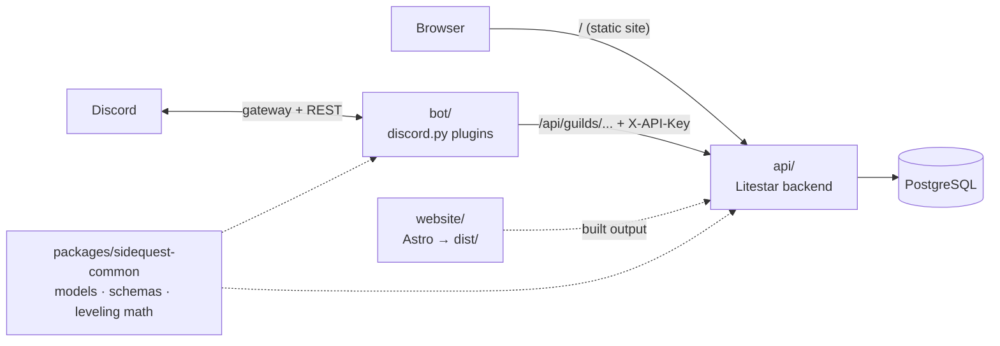

# SideQuest Guild

Everything for the SideQuest guild in one repo: the guild website, the Discord bot ("Game Master"), and a single
Litestar backend that serves both (and addons later). Structure follows [byte](https://github.com/JacobCoffee/byte):
a uv workspace where the backend owns the data and the bot talks to it over HTTP.



| Path | What lives there |
|---|---|
| `api/` | The Litestar backend: `domain/{guilds,levels,cases,role_menus,system}`, migrations in `lib/migrations`, website serving in `lib/website.py` |
| `bot/` | Discord bot: `bot.py`, `api_client.py` (the only way the bot reaches the backend), `plugins/*` (auto-loaded), `lib/` |
| `website/` | Guild website (Astro, static build). Its built `website/dist/` is served by the backend at `/` |
| `packages/sidequest-common` | ORM models, pydantic schemas (the API contract), leveling curve, message templates, settings |
| `tests/` | API tests run the real app on a per-test SQLite DB; bot tests cover the pure logic behind each plugin |

### Routes

| Path | Auth | Purpose |
|---|---|---|
| `/` | none | Website (`website/dist`, built by `make web-build`; a placeholder page until the first build) |
| `/api/guilds/{guild_id}/...` | `X-API-Key` (shared secret with the bot) | Guild config, XP/levels, moderation cases, role menus |
| `/health`, `/health/live` | none | Health checks |
| `/schema` | none | OpenAPI docs |

Only the bot's guild router is behind the bot key. Website and member routes get their own auth (e.g. Discord OAuth)
when they're added.

## Running locally

Requires uv (Python 3.15 is installed from `.python-version`), [mise](https://mise.jdx.dev) (the website's Node is
pinned in `website/mise.toml`), Docker (for Postgres), and the bot's token (Developer Portal → Game Master → Bot). The
bot needs the **Server Members** and **Message Content** privileged intents enabled in the portal.

```bash
cp .env.example .env              # then set API_KEY to a random secret
make install                      # uv sync + the website's Node and npm packages
make db-up migrate                # Postgres in Docker + apply migrations
make web-build                    # build the site into website/dist
make api                          # http://localhost:8000: site at /, OpenAPI docs at /schema
make bot                          # in another terminal
make web-dev                      # optional: the site with hot reload at http://localhost:4321
```

`make bot` uses `DISCORD_TOKEN` from the environment or `.env`; if neither is set it reads the macOS Keychain item
`discord-mcp` (the same token the Discord MCP server uses), so the token never has to sit in a file.
`DISCORD_GUILD_ID` makes slash commands sync to that server instantly instead of globally.

`make ci` runs what GitHub Actions runs: ruff format and lint, pyrefly, codespell, the test suite (deprecation warnings
are errors), and for the website oxfmt, oxlint, `astro check`, and a build. pyrefly fails only on type errors that
aren't recorded in `pyrefly-baseline.json`; after fixing some, `make type-baseline` re-records it. `make fmt` formats
both sides, `make lint` runs every prek hook (`make install-prek` installs them), and `make help` lists the rest.
`make migration MSG="..."` autogenerates a migration after a model change.

The website's Discord buttons read one constant, `DISCORD_INVITE` in `website/src/config.ts`. Its paintings live in
`website/assets/plates/` and are resized to WebP at build time.

## Features

Admin command groups are hidden from members without the listed permission (server admins can re-scope them under
Server Settings → Integrations). Every config change is stored by the API and applies immediately.

### Leveling
Every message earns 15–25 XP, at most once per 60 s per member, on MEE6's curve (`5n² + 50n + 100` XP from level
`n` to `n+1`). Level-ups post `GG {mention}, you just advanced to level {level}!` in the same channel unless a
level-up channel is set. Milestone roles (`Lv 5 · Wayfarer` … `Lv 50 · Legend`) are granted automatically; they're
cosmetic and sit below the rank roles, so rank colors and member-list groups stay in charge.

- `/rank [member]`, `/leaderboard [page]`
- `/levels reward set|remove|list` · `/levels set-xp` (Manage Server)
- `/levels config enabled | level-up-channel | level-up-message | xp-range | cooldown | stacking | no-xp-channel-add/remove | no-xp-role-add/remove`

### Logging (`#guild-log`)
Message edits/deletes (with the original text), bulk deletes (with a transcript file), joins (new accounts flagged),
leaves, nickname/role/timeout changes, bans/kicks/unbans by humans (with moderator and reason), channel and role
changes, and voice joins/leaves/moves. The bot's own moderation actions are logged as cases instead.

- `/logging channel <channel|none>`, `/logging status` (Manage Server)

### Welcome
New members get the auto-role (**New Arrival**) and a welcome message in `#general`. If membership screening is on,
both wait until the member accepts the rules. Placeholders: `{mention}` `{user}` `{guild}` `{member_count}`.

- `/welcome channel | message | autorole | test | status` (Manage Server)

### Role menus
Button panels for self-assignable roles. Buttons keep working across bot restarts. `max_roles` limits picks per menu.

- `/rolemenu create | add | remove | edit | delete | list | refresh` (Manage Roles)

### Moderation
Each action DMs the member (if possible), records a numbered case, and posts it to the log channel. Moderators can't
act on the owner, the bot, themselves, or anyone whose top role is at or above theirs.

- `/warn`, `/timeout <duration like 10m, 1h30m, 2d>`, `/untimeout` (Timeout Members)
- `/kick` (Kick Members) · `/ban [delete_message_days]`, `/unban <user id>` (Ban Members)
- `/cases [member]`, `/case <number>`, `/reason <number> <text>`

### Automod
Deletes invite links (on by default) and optionally all links; for mention spam (more than 5 mentions) or message
floods (more than 5 messages in 5 s) it also times the member out for 5 minutes. Each hit is recorded as an `automod`
case. Members with Manage Messages, exempt roles, and exempt channels are skipped.

- `/automod status | toggle | mentions | spam | timeout | exempt role|channel add|remove` (Manage Server)

## Role safety
Anything the bot hands out on its own (level rewards, the auto-role, role-menu buttons) goes through
`bot/src/sidequest_bot/lib/roles.py`:

- **The role itself:** it must be below the bot's role, not managed by an integration, and free of moderator/admin
  permissions. This is re-checked right before every grant, so a role that later gains permissions stops being
  handed out.
- **Who configures it:** they need Manage Roles, and the role must sit below their own highest role.

## Hosting
Not decided yet. The API needs Postgres and the bot needs a long-running process. Both read all configuration from the
environment (`DB_*`, `API_*`, `DISCORD_*`; see `.env.example`).
